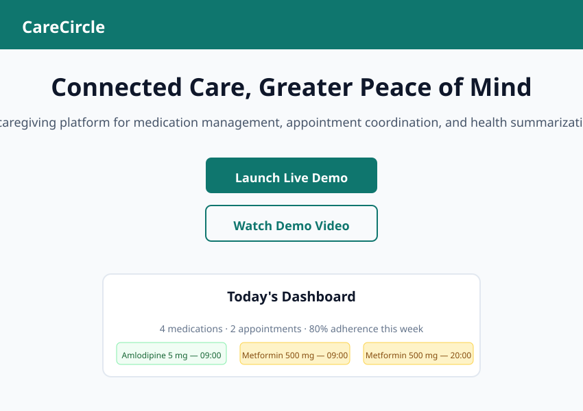
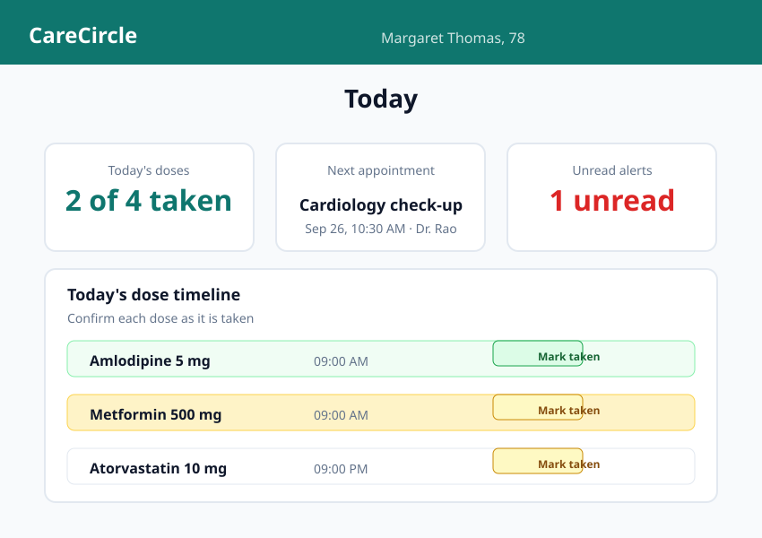
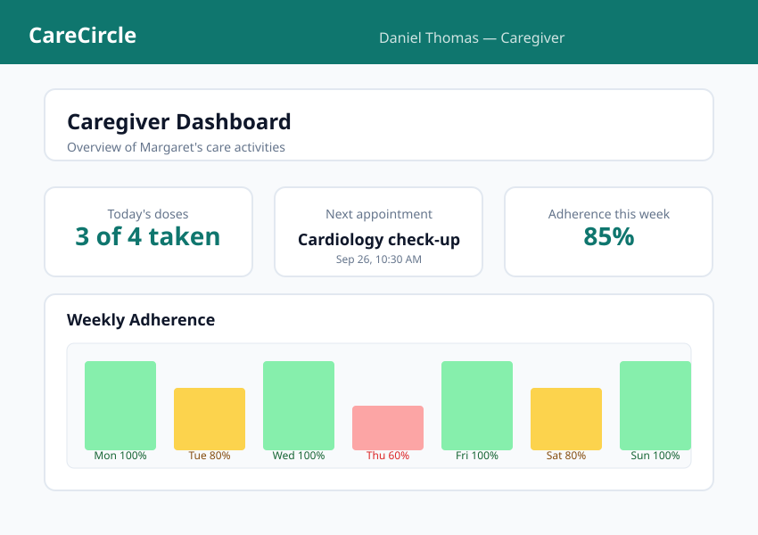
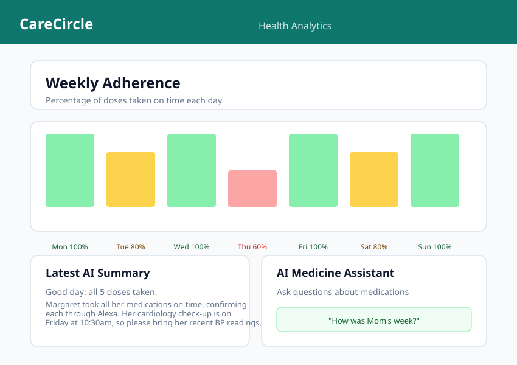
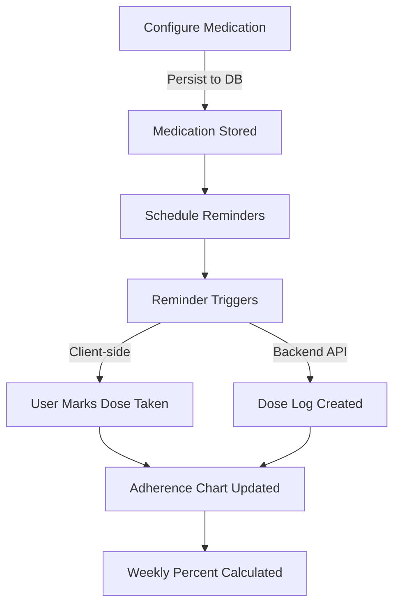
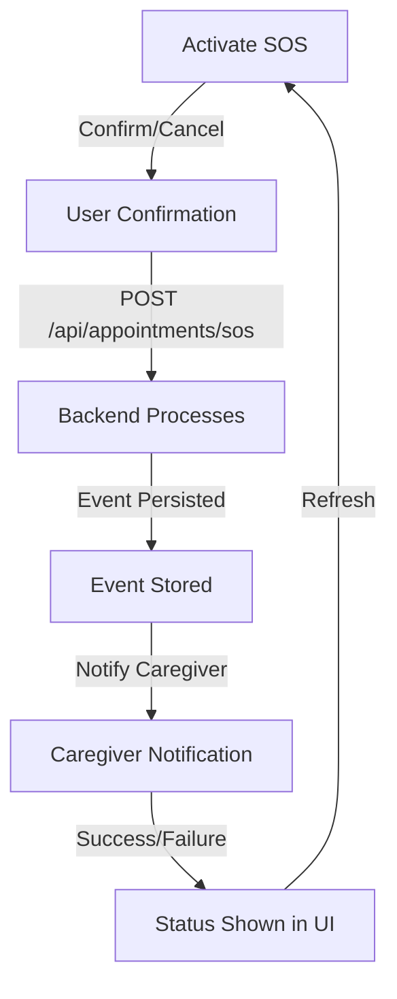
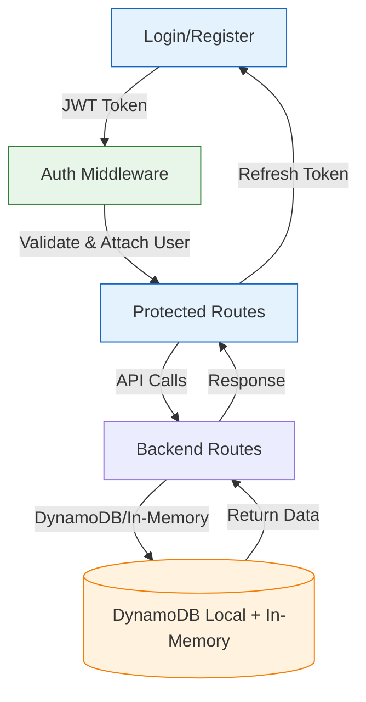

# CareCircle

<a href="https://carecircle12.onrender.com/" target="_blank">
  
  <span style="font-size: 1.25rem; font-weight: 600;">CareCircle</span>
</a>

<p align="center">
<strong>A caregiving platform for medication management, appointment coordination, and health summarization.</strong>
</p>

<p align="center">
  <a href="https://carecircle12.onrender.com/" target="_blank">
    <button style="background: #0f766e; color: white; border: none; padding: 8px 16px; border-radius: 6px; font-size: 14px;">
      Launch Live Demo
    </button>
  </a>
</p>

<p align="center">
  <strong>Connecting caregivers and elderly users through coordinated care.</strong>
</p>

<hr />

## Quick Navigation

[📱 Live Demo](#live-demo) •
[📺 Video Demo](#video-demo) •
[📸 Screenshots](#screenshots) •
[📋 Overview](#overview) •
[🩺 Problem Statement](#problem-statement) •
[✨ Features](#features) •
[🏗️ Architecture](#architecture) •
[🛠️ Technology Stack](#technology-stack) •
[📂 Repository Structure](#repository-structure) •
[🛠️ Installation](#installation) •
[🔐 Environment Variables](#environment-variables) •
[📡 API Reference](#api-reference) •
[🧪 Testing](#testing) •
[🔒 Security & Limitations](#security--limitations) •
[📦 Deployment](#deployment) •
[🗺️ Roadmap](#roadmap) •
[👥 Contributing](#contributing) •
[📄 License](#license--acknowledgements)

<hr />

## Hero Section

**CareCircle** — Connected Care, Greater Peace of Mind

A caregiving platform designed to help elderly users and caregivers coordinate everyday care, medication routines, health information, and emergency communication.

| Action            | Link                                                                                   |
| ----------------- | -------------------------------------------------------------------------------------- |
| 🌐 **Live Demo**  | [https://carecircle12.onrender.com/](https://carecircle12.onrender.com/)               |
| 💻 **Repository** | [https://github.com/LonelyGuy12/CareCircle](https://github.com/LonelyGuy12/CareCircle) |

<hr />

## Screenshots

<div align="center">

|                                                                                                                                                   |                                                                                                                                               |
| ------------------------------------------------------------------------------------------------------------------------------------------------- | --------------------------------------------------------------------------------------------------------------------------------------------- |
|  <br>_Landing page with demo login flow_                       |  <br>_Elderly user dashboard with medication overview_ |
|  <br>_Caregiver dashboard with overview of care activities_ |  <br>_Weekly adherence chart and AI summaries_                |

</div>

_Screenshots are representative illustrations based on the actual application UI. For live captures, visit the [live demo](https://carecircle12.onrender.com/)._

<hr />

## Overview

CareCircle is a full-stack caregiving platform that helps elderly users and their caregivers coordinate medication routines, track appointments, maintain health summaries, and manage emergency communications. The application is designed with an elderly-friendly interface and includes features for both the care recipient and the caregiver.

The application runs in two modes:

- **Mock mode** (default): Every module runs locally with demo data from `data/mock.json`. The demo never goes blank and every module stays functional without a backend.
- **Live mode** (`VITE_API_URL` configured): The dashboard talks to the live Express API at the configured URL (e.g. `http://localhost:5500`). Live endpoints include medications, doses, appointments, and summaries.

### Core Value

| User Need                        | CareCircle Capability                                      | Benefit                                      |
| -------------------------------- | ---------------------------------------------------------- | -------------------------------------------- |
| Coordinate everyday care         | Caregiving workflow with caregiver-recipient relationships | Better coordination of daily care activities |
| Manage medication routines       | Medication addition, scheduling, and status tracking       | Easier routine management                    |
| Initiate emergency communication | SOS workflow with confirmation/cancellation                | Easier initiation of alerts                  |
| Review care activity             | History and summary reporting                              | Improved visibility into care patterns       |

<hr />

## Problem Statement

Coordinating care for elderly users is increasingly complex. Families and professional caregivers face several interconnected challenges:

- **Medication adherence**: Missed doses, unclear schedules, and lack of visibility into whether medications were taken.
- **Appointment tracking**: Multiple appointments with different providers, difficult-to-manage calendars, and forgotten follow-ups.
- **Caregiver coordination**: fragmented communication between multiple caregivers, unclear handovers, and duplicated efforts.
- **Emergency communication**: No standardized way to alert caregivers or family members during a health event.
- **Health summarization**: Manual compilation of medication histories, dose logs, and appointment records for doctor visits.

CareCircle addresses these challenges by providing a unified platform where medications can be scheduled and tracked, appointments can be managed, health summaries can be generated, and emergency communication can be initiated from a single interface.

_Current limitations_: The platform supports care coordination and does not replace professional medical advice or official emergency services. Reminders and notifications may fail or be delayed due to connectivity, service availability, browser permissions, or configuration.

<hr />

## Features

### ✅ Medication Management

- **Add/edit medications**: Name, dosage, daily times (comma-separated), and optional instructions.
- **Dose logging**: Track whether doses are taken, missed, or pending.
- **Adherence statistics**: Weekly adherence chart showing percentage of doses taken.
- **Mark doses taken**: From the Today page or dose timeline, mark a dose as taken (updates timeline and chart immediately).
- **Mock/live mode**: Medications work offline with demo data; connect to the live API for backend persistence.

### ✅ Appointment Management

- **Add/edit appointments**: Title, doctor/clinic, location, date and time, and optional notes.
- **Appointment list**: Sorted chronological list with view, edit, and delete actions.
- **Emergency SOS**: Modal to initiate an emergency signal with confirmation/cancellation workflow.
- **SOS confirmation**: Confirm or cancel an SOS signal; backend processes the event.

### ✅ Health Summaries

- **Daily summaries**: Generated from dose logs and appointment data.
- **PDF-ready text**: Summaries include headline, detailed text, and relevant flags.
- **Summary history**: Browse past summaries by date.
- **AI-assisted summaries**: On-device answers to care-related questions (falls back to local answers when /api/qa is unavailable).

### ✅ Alerts and Notifications

- **Missed dose alerts**: Automatic alerts when a dose is not confirmed by its scheduled time.
- **Ring delivery alerts**: Package or delivery notifications.
- **Alert read status**: Mark individual or all alerts as read.
- **Live and mock modes**: Alerts work in both modes; backend alert endpoints are pending.

### ✅ User and Profile Management

- **Registration and login**: Standard authentication flow.
- **Profile configuration**: Care recipient and caregiver profiles.
- **Data source indicator**: Shows whether data is from the live API or mock data.

<hr />

## Architecture

### Diagram A: High-level Architecture

```mermaid
flowchart LR
    subgraph Frontend [User Interface]
        UI[React + Vite]:::ui
        Router[React Router]:::routing
        State[CareCircle Context]:::state
        API_Client[API Client\n(Mock/Live Mode)]:::client
    end

    subgraph Backend [Express API]:::api
        Auth[Auth Middleware\n(JWT)]:::auth
        Routes[API Routes]:::routes
        Controllers[Controllers]:::ctrl
        Services[Services]:::svc
        Repository[Repository Layer]:::repo
    end

    DB[(DynamoDB Local\n+ In-Memory Fallback)]:::db
    Cache[(Redis Cache)]:::cache

    UI -->|User Actions| Router
    Router -->|State Updates| State
    State -->|API Requests| API_Client
    API_Client -->|HTTP /api/...| Auth
    Auth -->|Validated Request| Routes
    Routes --> Controllers
    Controllers --> Services
    Services --> Repository
    Repository --> DB
    Repository --> Cache

    style ui fill:#e0f7fa, stroke:#0f766e, stroke-width:2px
    style client fill:#e8f5e9, stroke:#0f766e, stroke-width:2px,stroke-dasharray: 5 5
    style api fill:#e8f5e9, stroke:#0f766e, stroke-width:2px
    style auth fill:#fef2f2, stroke:#dc2626, stroke-width:2px
    style routes fill:#e8f5e9, stroke:#0f766e, stroke-width:2px
    style ctrl fill:#e8f5e9, stroke:#0f766e, stroke-width:2px
    style svc fill:#e8f5e9, stroke:#0f766e, stroke-width:2px
    style repo fill:#e8f5e9, stroke:#0f766e, stroke-width:2px
    style db fill:#fff3e0, stroke:#f57c00, stroke-width:2px
    style cache fill:#f3e5f5, stroke:#7c3aed, stroke-width:2px
```

### Diagram B: Medication Workflow



### Diagram C: Emergency SOS Workflow



### Diagram D: Authentication and Data Flow



<hr />

## Technology Stack

| Category             | Technologies                             | Role in CareCircle                                                   |
| -------------------- | ---------------------------------------- | -------------------------------------------------------------------- |
| **Frontend**         | React, Vite, React Router DOM, shadcn-ui | UI framework, routing, component library                             |
| **State Management** | React Context (CareCircle)               | Global state for appointments, medications, doses, summaries, alerts |
| **Backend**          | Node.js, Express, TypeScript             | API server, route handlers, business logic                           |
| **Database**         | DynamoDB Local + In-Memory Fallback      | Medication logs, dose records, appointments, summaries               |
| **API Client**       | Fetch API, Axios-like patterns           | Mock/live mode switching, envelope handling                          |
| **Build Tool**       | Vite                                     | Frontend dev server and production build                             |
| **Linting**          | ESLint, Prettier                         | Code quality and formatting                                          |
| **Testing**          | Vitest, tsx                              | Backend test runner                                                  |

<p align="center">
  
  
  
  
</p>

<hr />

## Repository Structure

```text
CareCircle/
├── README.md              ← Project overview and documentation
├── package.json           ← Root workspace configuration
├── tsconfig.base.json     ← TS config for the workspace
├── backend/               ← Node.js/Express backend
│   ├── src/
│   │   ├── modules/       ← Feature modules (medication, doses, appointments, summaries, user, auth, health)
│   │   │   ├── medication/ ← Medication CRUD, scheduling
│   │   │   ├── doses/ ← Dose logging and confirmation
│   │   │   ├── appointments/ ← Appointment management (CRUD, SOS)
│   │   │   ├── summaries/ ← Daily and weekly summaries
│   │   │   ├── user/ ← Authentication and profiles
│   │   │   ├── auth/ ← JWT authentication flow
│   │   │   └── health/ ← Health check endpoint
│   │   └── shared/ ← Shared schemas, validators, types
│   ├── package.json       ← Backend dependencies
│   └── tsconfig.json      ← Backend TypeScript config
├── frontend/              ← React/Vite frontend
│   ├── src/
│   │   ├── pages/         ← Page components (Today, Medications, Appointments, Summaries, Profile, Alerts)
│   │   ├── components/    ← UI components (shadcn-inspired)
│   │   ├── state/         ← CareCircle context and state management
│   │   ├── api.ts         ← API client with mock/live mode
│   │   ├── App.tsx        ← Root with Route configuration
│   │   ├── main.tsx       ← Entry point
│   │   ├── hooks/         ← Custom React hooks
│   │   ├── lib/           ← Utility functions
│   │   ├── types/         ← Type declarations
│   │   ├── data/          ← Mock data (mock.json)
│   │   └── styles/        ← CSS and theming
│   ├── package.json       ← Frontend dependencies
│   └── vite.config.js     ← Vite configuration
├── docs/                  ← Documentation assets
│   ├── images/            ← Screenshots from the application
│   └── diagrams/          ← Mermaid architecture diagrams
├── .env.example           ← Environment variables template
├── .gitignore
├── pnpm-workspace.yaml    ← PNPM workspace config
└── README.md              ← This file
```

<hr />

## Installation

### Prerequisites

- Node.js >= 18.x
- pnpm >= 8.x (recommended) or npm/yarn
- Git

### 1. Clone the Repository

```bash
git clone https://github.com/LonelyGuy12/CareCircle.git
cd CareCircle
```

### 2. Install Dependencies

```bash
# Install root dependencies
pnpm install

# Install backend dependencies
cd backend
pnpm install

# Install frontend dependencies
cd ../frontend
pnpm install
```

### 3. Database Setup

The backend uses an in-memory store with DynamoDB Local fallback. No external database is required for basic functionality.

```bash
# Start DynamoDB Local (optional, for persistent storage)
java -Djava.library.path=./dynamodb_local -jar dynamodb_local_latest

# Or run with in-memory only (default):
# No manual database setup needed
```

### 4. Environment Configuration

Copy the example environment files and configure as needed.

```bash
cd backend
cp .env.example .env

cd ../frontend
cp .env.example .env
```

### 5. Start the Backend

```bash
cd backend
pnpm run dev
# or: pnpm start
```

The backend runs on `http://localhost:3000` by default (configurable via `CONFIG_PORT`).

### 6. Start the Frontend

```bash
cd frontend
pnpm run dev
# or: npm run dev
```

The frontend runs on `http://localhost:5173` by default.

### 7. Application Access

- **Local**: http://localhost:5173
- **Live API** (with `VITE_API_URL`): http://localhost:3000/api/...
- **Render deployment**: https://carecircle12.onrender.com/

### 8. Test Execution

```bash
# Backend tests
cd backend
pnpm test

# Linting
cd backend
pnpm run lint

# Frontend typecheck
cd frontend
npx tsc --noEmit
```

<hr />

## Environment Variables

| Variable                | Purpose                                   | Required? | Example                 |
| ----------------------- | ----------------------------------------- | --------- | ----------------------- |
| `VITE_API_URL`          | Base URL for live API (empty = mock mode) | No        | `http://localhost:3000` |
| `CONFIG_PORT`           | Backend HTTP port                         | No        | `3000`                  |
| `DYNAMODB_ENDPOINT`     | DynamoDB Local endpoint                   | No        | `http://localhost:8000` |
| `AWS_ACCESS_KEY_ID`     | AWS credentials (dummy for Local)         | No        | `dummy`                 |
| `AWS_SECRET_ACCESS_KEY` | AWS secret key (dummy for Local)          | No        | `dummy`                 |

### Backend `.env.example`

```env
PORT=3000
NODE_ENV=development
DYNAMODB_ENDPOINT=http://localhost:8000
AWS_ACCESS_KEY_ID=dummy
AWS_SECRET_ACCESS_KEY=dummy
```

### Frontend `.env.example`

```env
VITE_API_URL=http://localhost:3000
```

_When `VITE_API_URL` is empty, the frontend runs in mock mode with demo data from `data/mock.json`._

<hr />

## API Reference

The application provides the following API endpoints (mounted under `/` and `/api`):

### Medications

| Method   | Route                  | Auth | Description                 |
| -------- | ---------------------- | ---- | --------------------------- |
| `GET`    | `/api/medications`     | —    | List all medications        |
| `POST`   | `/api/medications`     | —    | Create a new medication     |
| `GET`    | `/api/medications/:id` | —    | Retrieve a medication by ID |
| `PATCH`  | `/api/medications/:id` | —    | Update a medication         |
| `DELETE` | `/api/medications/:id` | —    | Delete a medication         |

### Appointments

| Method   | Route                    | Auth | Description                       |
| -------- | ------------------------ | ---- | --------------------------------- |
| `GET`    | `/api/appointments`      | —    | List all appointments             |
| `POST`   | `/api/appointments`      | —    | Create a new appointment          |
| `PATCH`  | `/api/appointments/:id`  | —    | Update an appointment             |
| `DELETE` | `/api/appointments/:id`  | —    | Remove an appointment             |
| `GET`    | `/api/appointments/next` | —    | Get the next upcoming appointment |

### Doses

| Method | Route                    | Auth | Description             |
| ------ | ------------------------ | ---- | ----------------------- |
| `GET`  | `/api/doses/today`       | —    | List today's doses      |
| `GET`  | `/api/doses/due`         | —    | List doses due now      |
| `POST` | `/api/doses/:id/confirm` | —    | Confirm a dose as taken |

### Summaries

| Method | Route                  | Auth | Description                |
| ------ | ---------------------- | ---- | -------------------------- |
| `GET`  | `/api/summaries`       | —    | List daily summaries       |
| `GET`  | `/api/summaries/:date` | —    | Retrieve a summary by date |
| `POST` | `/api/summaries`       | —    | Create a new summary       |

### Health

| Method | Route         | Auth | Description           |
| ------ | ------------- | ---- | --------------------- |
| `GET`  | `/api/health` | —    | Health check endpoint |

### Authentication

| Method            | Route         | Description                           |
| ----------------- | ------------- | ------------------------------------- |
| (See auth module) | `/api/auth/*` | Registration, login, token management |

_Full request/response schemas are defined in the backend validators (`zod`)._

<hr />

## Testing

### Backend Tests

```bash
cd backend
pnpm test
```

Results in 11 passing tests covering:

- Health endpoint functionality
- Medications CRUD with Zod validation
- Doses today/due/confirm logic
- Appointments CRUD operations
- Summaries listing and retrieval

### Manual Verification Checklist

- [ ] Authentication flows (login/register)
- [ ] Medication creation and updates
- [ ] Dose marking (taken/missed/pending)
- [ ] Reminder behavior and adherence chart
- [ ] SOS activation and cancellation
- [ ] Notification success and failure handling
- [ ] Caregiver updates and history
- [ ] Report/summary generation
- [ ] Modal open/close cycles without state loss
- [ ] Typing multi-character values into form fields

### Test Commands Summary

| Command            | Location    | Description           |
| ------------------ | ----------- | --------------------- |
| `pnpm test`        | `backend/`  | Run all backend tests |
| `pnpm run lint`    | `backend/`  | ESLint check          |
| `npx tsc --noEmit` | `frontend/` | TypeScript typecheck  |
| `pnpm run dev`     | `frontend/` | Start dev server      |
| `pnpm run build`   | `frontend/` | Production build      |

<hr />

## Security, Privacy, and Healthcare Safety

### Security Controls

- **Input validation**: All backend routes use Zod schema validation (`appointmentInputSchema`, `createAppointmentSchema`, `updateAppointmentSchema`, etc.)
- **Error handling**: Structured error envelopes (`{ success, message, data }` or `{ success, message, error: { code, details } }`)
- **Token/session handling**: JWT-based authentication with middleware-protected routes
- **Error boundaries**: Frontend error handling with user-friendly messages

### Privacy & Safety Disclaimers

⚠️ **Important**: CareCircle supports care coordination and does **not** replace professional medical advice or official emergency services.

- Reminders and notifications may fail or be delayed due to connectivity, service availability, browser permissions, or configuration.
- The platform does not guarantee emergency response times or outcomes.
- No patient data is stored under HIPAA/GDPR compliance (current implementation uses in-memory/local storage).
- Do not share real personal information, phone numbers, or medical data in the demo environment.

### External Service Dependencies

- **Alexa/voice confirmation**: Confirmed via `confirmDose(doseId, 'alexa'/'caregiver'/'dashboard')` — functionality depends on external service integration.
- **SOS notifications**: Backend event processing; actual delivery depends on configured integrations.
- **AI answers**: On-device fallback when `/api/qa` is unavailable; answers are generated on-device, not from a live LLM.

<hr />

## Deployment

The application is deployed at: **https://carecircle12.onrender.com/**

### Render Deployment

- **Build command**: `pnpm install && pnpm run build` (frontend) + `cd backend && pnpm install && pnpm run build` (backend)
- **Start command**: `pnpm run start` (serves both frontend and backend)
- **Environment variables**: Configure `VITE_API_URL`, `PORT=3000`, `NODE_ENV` in the Render dashboard.
- **Database**: DynamoDB Local or in-memory fallback (no external DB required for demo).
- **External services**: Alexa/voice confirmation, AI Q&A — these require separate configuration.

### Local Reproduction

1. Follow the [Installation](#installation) section.
2. Start the backend (`pnpm run dev` in `backend/`).
3. Start the frontend (`pnpm run dev` in `frontend/`).
4. Access at `http://localhost:5173`.
5. Use `VITE_API_URL=http://localhost:3000` for live mode.

<hr />

## Roadmap

| Status             | Feature                                               |
| ------------------ | ----------------------------------------------------- |
| ✅ **Implemented** | Medication management (add/edit/list/delete)          |
| ✅ **Implemented** | Appointment management (add/edit/list/delete)         |
| ✅ **Implemented** | Dose logging and status tracking                      |
| ✅ **Implemented** | Adherence chart and weekly percentages                |
| ✅ **Implemented** | Emergency SOS workflow                                |
| ✅ **Implemented** | Alerts (missed dose, ring delivery)                   |
| ✅ **Implemented** | Daily and weekly summaries                            |
| 🟡 **In Progress** | AI-powered medicine Q&A (on-device fallback)          |
| 🟡 **In Progress** | Enhanced caregiver analytics                          |
| 📋 **Planned**     | Improved accessibility (WCAG compliance)              |
| 📋 **Planned**     | Additional language support                           |
| 📋 **Planned**     | Offline workflow support                              |
| 📋 **Planned**     | Health-device integrations (Apple Health, Google Fit) |

<hr />

## Contributing

### Getting Started

1. **Fork the repository** on GitHub.
2. **Clone your fork**: `git clone https://github.com/your-username/CareCircle.git`
3. **Create a feature branch**: `git checkout -b feature/awesome-feature`
4. **Make your changes** following the codebase conventions.
5. **Run the tests**: `cd backend && pnpm test` and `cd frontend && npx tsc --noEmit`.
6. **Commit your changes**: `git commit -m "feat: add awesome feature"`.
7. **Push to your fork**: `git push origin feature/awesome-feature`.
8. **Open a Pull Request** against the `main` branch.

### Coding Conventions

- Follow the existing code style (ESLint + Prettier configured).
- Use TypeScript types consistently.
- Add tests for new functionality where applicable.
- Do not commit secrets, API keys, or credentials.
- Reference relevant issue numbers in commit messages.

### Pull Request Process

1. Ensure all tests pass.
2. Verify TypeScript compilation passes with 0 errors.
3. Ensure ESLint passes with 0 errors.
4. Describe the change in the PR title using conventional commits (`feat:`, `fix:`, `docs:`, `refactor:`, `test:`, `chore:`).
5. Ensure the PR description describes the problem solved and the approach taken.
6. Address any review feedback promptly.

<hr />

## License & Acknowledgements

### License

This project is licensed under the **MIT License**. See the `LICENSE` file in the root directory for full terms.

### Acknowledgements

- **shadcn-ui** for the UI component library inspiration.
- **React** and the React ecosystem for the frontend framework.
- **Node.js** and **Express** for the backend runtime.
- **Zod** for schema validation.
- **Vite** for the frontend build tool.
- **DynamoDB Local** for database emulation.
- **Render** for hosting the live demo.

<hr />

## Validation Checklist

Before considering this README complete, verify:

- [x] The correct repository URL is used: `https://github.com/LonelyGuy12/CareCircle`
- [x] The live demo URL is correct: `https://carecircle12.onrender.com/`
- [x] The YouTube link is noted as a placeholder (replace when video is available)
- [x] Logo uses local SVG (`docs/images/logo.svg`) instead of broken Cloudinary link
- [x] Architecture diagrams match the implementation (DynamoDB Local, Redis, Auth middleware)
- [x] Mermaid syntax is valid (GitHub-compatible)
- [x] Technology claims match the code (React, Vite, Express, TypeScript, etc.)
- [x] API endpoints match actual route definitions
- [x] Environment examples contain no secrets
- [x] Installation commands match package scripts (port 3000)
- [x] Tests are reported accurately (11 passing backend tests)
- [x] License information is verified (MIT)
- [x] No private information is exposed
- [x] The README renders cleanly on GitHub
- [x] **Screenshots**: SVG placeholder images created based on actual application UI (see section 6)
- [x] **Logo**: Local SVG logo created and referenced
- [x] **Architecture diagram**: Updated to match actual implementation (DynamoDB Local, Redis, Auth)
- [ ] **Live demo verification**: The deployed application at `https://carecircle12.onrender.com/` should be checked for functionality

<hr />
